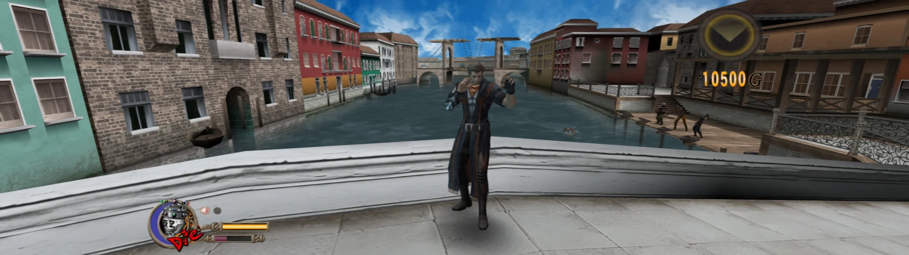
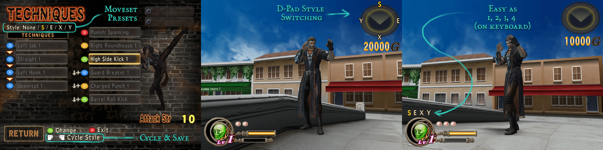
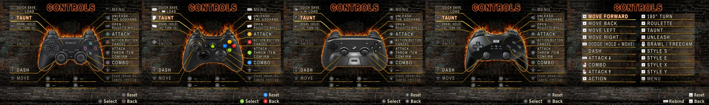

# God Hand: Rearmed (かみて · おもてなし)

**God Hand for PS2. Recompiled, Refined, Rearmed.**

An unofficial, fan-made native PC port of Clover Studio's **God Hand** (PlayStation 2, 2006). The game's own code is
recompiled into a Windows program: no emulator running the show. It plays start to credits at a smooth 60, on any
screen, with as much or as little of our own nonsense as you want.

> [!WARNING]
> **Beta!** Plays from the first punch to the credits, but expect the odd bug. Found one? [Tell us](#found-a-bug).

> **No game files included!** Play your own damn copy! (USA, SLUS-21503; see [DISC_HASHES.md](DISC_HASHES.md)).

<!-- MEDIA: assets/readme/hero.gif — the hero shot: a fight at 60 FPS, widescreen -->

## Get It Running

1. Grab the latest `GHR-v….zip` from [Releases](https://github.com/God-Hand-Rearmed/God-Hand-Rearmed/releases).
2. Unzip it somewhere you can write to, **Not Program Files**!
    * The launcher updates the game in place and Windows won't let it write there.
3. Run **GHR.exe**. 
    * Windows SmartScreen may complain about an unknown publisher: **More info > Run anyway**.
4. Point the launcher at your disc image (.iso or .chd) once, and it checks it for you.
5. Pick a preset and hit "**Play**"! 
    * Beat thugs™, demons™, women™!

The first start compiles shaders for your GPU, so the screen may stay black before coming back. Patience, young ass-whooper.

### Linux and Steam Deck

1. Grab `GHR-v…-Linux-x64.AppImage` (one file) or `GHR-v…-Linux-x64.tar.gz` (a folder) from
   [Releases](https://github.com/God-Hand-Rearmed/God-Hand-Rearmed/releases).
2. AppImage: make it executable (file manager > Properties > Is executable, or `chmod +x`) and run it. Settings and
   saves go to `~/.local/share/GodHandRearmed` (or into a `GHR-data` folder you make next to the AppImage).
   Folder: unpack it anywhere you can write to and run `GHR`; it keeps everything inside, like the Windows zip.
3. Point the launcher at your disc image once (it also looks in `~/Games`, `~/Downloads` and on your SD card), pick a
   preset, "**Play**"!
4. **Steam Deck:** do steps 1 to 3 in Desktop Mode, then hit **Add to Steam** in the launcher: back in Game Mode it's in
   your library with its artwork, fullscreen at the Deck's 16:10.

Needs glibc 2.31 or newer (any distro from 2020 on, SteamOS included) and a Vulkan driver.

When a new version is out, the launcher says so: **What's new** shows the changes, **Update** installs them and
restarts. Your settings, saves, and mods stay where they are.

## What's In It

<!-- MEDIA: assets/readme/launcher.png — the launcher -->

### God Hand - Gone Native!

Recompiled as a Windows program under Vulkan or DX11, and a Linux / Steam Deck one under Vulkan; PCSX2 as the renderer
until later.

---

### You've Been Hit by, You've Been Struck by, My Smooth Visuals!

True 60FPS (fists punching swiftly) game logic, that by a thousand fixes was achieved. <!-- tag:Fps60 --> `Remastered+`

<!-- MEDIA: assets/readme/60fps.gif — 30 vs 60 side by side -->
---

### Wider Than Yo Momma's!

I'll kick up your goddamn Aspect Ratio, boy! 

Up to 32:9. With enemy behavior adjusted, so everyone on screen is
invited to kick your ass, too! <!-- tag:AspectRatio --> `Remastered+`

No UI stretching in gameplay; menus at 4:3 unless you like 'em on the thicker side!

---

### Modern Controls, Tank Me Later!

Switch between classic tank controls and modern third-person freecam on the fly. <!-- tag:ControlStyle --> `Remastered+`

Includes a toggle to automatically enter Brawl Mode (tank controls) in combat.

The alpha's Hold to Brawl is back: hold L1 for tank controls, double-tap it to spin around. Rather toggle Brawl Mode with R3? Pick Modern: Toggle. `Remastered+`

---

### Smokin' S | E | X | Y Style Switching!

Set up Moveset Presets in the Techniques screen, switch with the d-pad in gameplay. <!-- tag:StyleSwitching --> `Rearmed+`

For the Buck Breakers out there, you can also pick your pummel per style. <!-- tag:BuckBreaker --> `Rearmed+`

---

### I'm Into BDSM: Bindings & Device Scheme Mappings!

Customizable controls with button prompts for Xbox, PlayStation, Nintendo, Steam, and keyboard and mouse (for the
freaks who want to play God Hand at their desks).

---

### Just Liek... Play Game!

Too many choices? How about just one? Pick a preset and get to playing right away.

> **NOTE:** Everything that changes Clover's original gameplay is opt-in, so no bitchin!

### The Presets

<!-- BEGIN GENERATED: presets (tools/readme/gen_readme.py) -->
| Preset | Tagline | What you get |
| --- | --- | --- |
| **Classic** | Clover's Vanilla Thrilla | Cinetastic 30FPS, 4:3, Classic Camera & Controls, as handed by God. |
| **Remastered** | Spitshine Edition | Smooth Sexy Silky 60FPS, Fills your screen - edge to edge, Modern Controls, etc. |
| **Rearmed** | That's the Spice! | Adds: New Cam Angle, Roulette Refinements, Moveset Presets, Buck Breaker, Busta-Chan Jive, and Misqué & Risqué. |
| **Sleazy Mode** | ...is Now Selectable! For the girl who just wants to have fun. | Adds: Cunt Punter, Tension - Off the Cuff, and Wild Curry Funk. |
<!-- END GENERATED: presets -->

Each one includes everything before it. Change any option a preset sets and you're on **Custom**. The tags below say
which preset first switches a feature on; `Toggle` means none does, it's yours to flip.

### Everything Else

**Controls**
- Camera & FOV presets (As on the PS2, Wider, Widest, Action) or your own field of view, distance and tilt; enemies conduct themselves accordingly at any setting. <!-- tag:CameraPreset --> `Remastered+`
- See Through: walls between you and the action go see-through instead of vanishing. <!-- tag:SeeThrough --> `Rearmed+`
- Menu controls - Western, Japanese or Classic: confirm on the button you're used to.
- (Nearly) every button rebindable, with a full keyboard & mouse layout and save states (F5 / F9; Select / Select + Start).

**Display & Graphics**
- Fullscreen (borderless), maximized or windowed; any aspect ratio from 4:3 to 32:9.
- Internal resolution up to 8x, Vulkan by default with Direct3D 11 as the fallback.
- Texture filtering from the PS2's own smoothing to Dangerously Crunchy, plus trilinear, anisotropic, FXAA,
  brightness and depth of field.
- HD texture packs in PCSX2's format, with the game's own transparency kept intact. (K recommends this [texture pack](https://gbatemp.net/threads/god-hand-usa-uhd-remaster-definitive-fixed-transparency-glitches.638847), and no, Santins, you didn't fix the transparency issues, but no worries, GHR fixed 'em for you)

**Interface**
- The HUD out at the screen edges or where the PS2 had it. <!-- tag:HudLayout --> `Remastered+`
- Sway Bar: a stun gauge for enemies and bosses. <!-- tag:SwayBar --> `Rearmed+`
- Button prompts that follow your controller (Xelu's prompt art; PlayStation pads keep the game's own).

**Gameplay**
- Click-Stick Dash: press and hold the stick (or bind) to dash. <!-- tag:L3Dash --> `Remastered+`
- Intro Skipper: skip developer intros straight to the title screen. <!-- tag:SkipIntro --> `Remastered+`
- Hard-On: Hard difficulty from the start, no clear needed. <!-- tag:UnlockHard --> `Remastered+`
- Target Select: switch Roulette targets with the right stick or the d-pad. <!-- tag:RouletteTargetCycle --> `Rearmed+`
- Dry Spinning: open the Roulette with no balls to your name. <!-- tag:RouletteNoOrbs --> `Rearmed+`
- Busta-Chan Jive: sprint attacks slide under and vault over railings and through windows. <!-- tag:SprintTraversal --> `Rearmed+`
- Misqué & Risqué: better shop and casino poses, and more. <!-- tag:Money --> `Rearmed+`
- Cunt Punter: Ball Buster works on women. <!-- tag:BallBusterWomen --> `Sleazy Mode`
- Tension is Placable: leash the God Hand early and keep what's left; Off the Cuff unleashes it with any Tension.
  <!-- tag:TensionPlacable --> `Sleazy Mode`
- Wild Curry Funk: pick up, carry and throw more objects. Mostly chairs. <!-- tag:LiftChairs --> `Sleazy Mode`
- Roulette Timer: double time to pick your move. <!-- tag:RouletteTimer --> `Toggle`

**Sound**
- Separate Music, Sound Effects and Voices volumes; Roulette Ratchet clicks as you flick. <!-- tag:RouletteRatchet --> `Remastered+`

**The Launcher**
- Install and check your disc, every option in one place, presets, Add to Steam (a library entry with art), and
  updates in place.

**Muscleanious Improvements**
> The following are default features of GHR you'll have to deal with cause I ain't cluttering the options any more than they already are:
- Spin Me Right Round: You can rotate Gene on the Techniques screen with the Right Stick.
- Roulette Finesse: You can scroll the Roulette with the d-pad, up and down too.
- Don't Not Fix What's Not Broken't: A bunch of base game bugs and minor issues were fixed.

## Controls

Defaults for new installs. Everything is rebindable in **Options > Controls** in game and in the launcher.

<!-- BEGIN GENERATED: controls (tools/readme/gen_readme.py) -->
| Action | Controller | Keyboard & mouse |
| --- | --- | --- |
| Move | Left stick | W A S D |
| Dodge | Right stick | Shift + W A S D |
| Combo | X / ▢ | Left click |
| Assigned move | Y / △ | Right click |
| Assigned move | A / ✕ | Space |
| Action (talk, pick up, open) | B / ○ | E |
| 180° turn | LB / L1 | Q |
| Roulette | RB / R1 | R |
| Taunt | LT / L2 | F |
| Unleash the God Hand | RT / R2 | G |
| Brawl mode / freecam *(Modern: Toggle)* | Right stick click | Middle click |
| Brawl mode while held, double-tap for the 180° turn *(Modern: Hold)* | LB / L1 | — |
| Dash *(Click-Stick Dash on the controller)* | Left stick click | Double-tap a direction |
| Styles S / E / X / Y *(Moveset Presets)* | D-pad up / right / down / left | 1 2 3 4 |
| Pause | Start / Options | Esc |
<!-- END GENERATED: controls -->

In menus the keyboard works as you'd expect: arrows or WASD to move, Enter / Space to confirm, Esc / Backspace to go
back, Q / E to switch tabs. **F2** opens the developer menu (live camera, poses, debug switches); **F3** the FPS counter;
**F11** fullscreen.

## Options

Every option, with the same help text you'll see in the launcher and in game.

<!-- BEGIN GENERATED: options (tools/readme/gen_readme.py) -->

<b>Controls</b>

**Camera**

- **Camera & FOV:** How far you see to the side. Works with Aspect Ratio; enemies adapt. *As on the PS2 / Wider / Widest / Action / Custom* (F2 while playing tunes it live) `Remastered+`
  - **Field of View:** How much the camera shows, both ways, outside fights. *100%: as on the PS2 / 110% / 120% / 130% / 140% / 150%*
  - **Field of View in Fights:** The same while the game's battle camera is on (Gene has an enemy targeted). 100% frames fights as on the PS2. *100%: as on the PS2 / 110% / 120% / 130% / 140% / 150%*
  - **Camera Distance:** At a wider field of view, how far back the camera stays. 0% keeps Gene the size he is at 100%; 100% shows more round him. *0%: Gene keeps his size / 50%: halfway out / 100%: wider view looks zoomed out*
  - **Camera Tilt:** At a wider field of view, the camera also rises and looks down at Gene by this much: more of the floor ahead, less sky. *None / 5 degrees / 10 degrees / 15 degrees*
- **Steady Idle Cam:** Whether the camera bobs with Gene. (F2 > Camera switches it while playing)
- **See Through:** Instead of removing walls, the camera sees through them around Gene and enemies. (F2 > Camera sizes it while playing) `Rearmed+`

**Controller**

- **Vibration:** Controller rumble. Girls know what it's for.
- **Left Stick Deadzone:** How far the left stick must move before it counts. Raise it if Gene walks on his own. *0% to 50%*
- **Right Stick Deadzone:** How far the right stick must move before it counts. Raise it if the camera drifts or Gene dodges on his own. *0% to 50%*
- **Menu Controls:** Western: bottom button confirms; right cancels. Japanese: right button confirms; bottom cancels. *Western / Japanese / Classic*

<b>Display</b>

**Game Window**

- **Display Mode:** Window, max window, or borderless fullscreen. You can also use F11, if you're into that. *Fullscreen (Borderless) / Maximized Window / Window*
  - **Window Size:** The window's size when it opens (not maximized or fullscreen). *Automatic (follows internal resolution) / PS2 size*
- **Aspect Ratio:** Screen width from 4:3 to wider than yo momma! *4:3 (the PS2's) / 16:9 / 16:10 / 21:9 / 32:9 / Match the screen* `Remastered+`
- **VSync:** On: no screen tearing. Off: for G-Sync | FreeSync. The rest get torn up. *On / Off*

<b>Graphics</b>

**Renderer**

- **Graphics API:** Default: Vulkan | Fallback: DX11 *Vulkan / Direct3D 11*
- **Internal Resolution:** 1x: 448p | 2x: 896p | 3x: 1344p | 4x: 1792p *1x native (512x448) / 2x 1024x896 / 3x 1536x1344 / 4x 2048x1792 / 5x 2560x2240 / 6x 3072x2688 / 8x 4096x3584*

**Textures**

- **Texture Filtering:** PS2: the game's original texture smoothing. Crunchy: unfiltered 3D. | Dangerously Crunchy: the UI too. *PS2 (Bilinear) / Crunchy (Unfiltered 3D) / Dangerously Crunchy (3D+UI)*
- **Trilinear Filtering:** PS2: the game's original texture smoothing. Forced: textures blend smoothly into the distance. *PS2 / Forced*
- **Anisotropic Filtering:** Keeps floors and walls sharp at a slant. Costs next to nothing. Max it out. *Off / 2x / 4x / 8x / 16x*

**Effects**

- **Anti-Aliasing:** FXAA smooths jagged edges. Makes the picture a little softer. Like you. *FXAA / Off*
- **Brightness:** 100% is the game as it was. Turn it up if you can't see who's kicking you. *50% to 150%*
- **Post Effects:** The blur effects (depth of field, heat haze) are drawn from small copies of the frame. PS2 resolution keeps them aligned but grainy at high internal resolutions; Upscaled draws them sharp. *PS2 resolution (PCSX2's fix) / Upscaled / No fix*
- **Depth of Field:** Blur in the distance. It can't hurt you. (F2 switches it while playing)

<b>Interface</b>

**HUD**

- **HUD Layout:** Where the health bar, radar, and the rest of the in-game HUD go on a wide screen. Wider than 16:9 keeps them at the edges of a 16:9 area. *16:9: HUD at the screen edges / 4:3: HUD where the PS2 had it* (F7 switches it while playing) `Remastered+`
- **Enemy Life Gauge:** Select whether to display an enemy's life gauge.
- **Sway Bar:** Stun gauge for enemies and bosses. Fills up till they're stunned, then drains. `Rearmed+`

**Menus & Prompts**

- **Menu Width:** Menus and screens (pause, options, roulette setup) are drawn for 4:3: shown 4:3 with side bars, or stretched to the screen. *4:3: as on the PS2, with side bars / Stretched to the screen*
- **Button Prompts:** Controller button hint style. This choice reflects your value as a person. *Automatic (follows your controller) / Xbox / PlayStation (the game's own) / Nintendo Switch / Steam*

**Overlays**

- **FPS Counter:** Framerate and game speed statistics.

<b>Gameplay</b>

**Speed & Feed**

- **60 FPS:** Play at a smooth sexy silky 60FPS. Leave OFF if you want the OG experience. `Remastered+`

**Move & Groove**

- **Control Style: Pad:** Classic: PS2's OG fixed facing brawling. Modern (rebindable): Toggle Brawl (R3) | Hold to Brawl (L1). *Classic / Modern: Toggle / Modern: Hold* (F2 > Controls changes it while playing) `Remastered+`
  - **Modern: Auto:** Brawling starts when dealing or taking damage. Press the stick (rebindable) to go back to freecam.
  - **Modern: Hold Mode:** Hold to Brawl: hold L1 to brawl, double-tap it to turn. Hold to Cam: hold L1 for freecam, tap it to turn. *Hold to Brawl / Hold to Cam* `Remastered+`
  - **Modern: Auto:** Brawling starts when dealing or taking damage. It stops once no enemy is near. `Remastered+`
- **Control Style: KBM:** Keyboard & mouse. Classic: PS2's OG brawling. Modern: mouse freecam. *Classic / Modern: Toggle* `Remastered+`
  - **Modern: Auto:** Brawling starts when dealing or taking damage. Middle-click (rebindable) to go back to freecam.
  - **Modern: Mouse Look:** Freak... (F2 > Controls sets the sensitivity)
- **Click-Stick Dash:** Press and hold the stick to dash. Rebindable in Controls. `Remastered+`
- **Busta-Chan Jive:** Sprint attacks go through 99% of obstacles. Slide right through, swooce right over. (F2 > Debug > Stage collision marks them) `Rearmed+`

**Style Shuffle**

- **Moveset Presets:** Configure up to 4 styles; switch with the d-pad. Letters around the radar show your sweet sexy styles. `Rearmed+`
  - **Signal Style Switch:** Gene calls out each style as you switch to it, and his God Hand flashes. `Rearmed+`
- **Buck Breaker:** Pick how to punish stunned enemies. Works with Moveset Presets. Some restrictions apply. `Rearmed+`

**Fightin' Excitement**

- **Cunt Punter:** Ball Buster works on women. Name changes on target. This also works IRL, though your mileage may vary. `Sleazy Mode`
- **Tension is Placable:** After unleashing the God Hand, pull the trigger again to leash it early and keep your remaining Tension. `Sleazy Mode`
  - **Off the Cuff:** Unleash the God Hand with any Tension, not just full. Gene is invulnerable only when unleashing at full Tension. `Sleazy Mode`
- **Wild Curry Funk:** Carry and throw more types of objects. Mostly chairs. If it's not obvious, this makes the game easier. `Sleazy Mode`

**Roulette Charrette**

- **Roulette Timer:** Time limit to select a move after opening the Roulette. Techniques fire off automatically at the end of the timer. *Normal / Double time*
- **Target Select:** Switch Roulette targets with the right stick and the d-pad. HINT: You can also use the d-pad to cycle Roulette moves. `Rearmed+`
- **Dry Spinning:** You can open the Roulette even when you don't have balls. HINT: You can use the Roulette camera for targeting. `Rearmed+`

**Skip Poker**

- **Intro Skipper:** Start at the main menu: no Capcom and Clover logos and no "Press Start" screen. `Remastered+`
- **Hard-On:** Hard can be picked from the start instead of after a clear. Your save is not changed. `Remastered+`

**Misqué & Risqué**

- **Better Shop & Casino Poses:** Give the shop and casino people better poses. Not sure what else you were expecting... (F2 > NPCs sets the poses) `Rearmed+`
- **Cash:** Recommended: 115% *100% to 130%* `Rearmed+`
- **Money:** Recommended: 115% *85% to 130%* `Rearmed+`

<b>Sound</b>

**Sound**

- **Mode:** Select between monaural, stereo, or surround sound. *Mono / Stereo / Dolby Pro Logic II*
- **Roulette Ratchet:** When you flick, it clicks. `Remastered+`

**Volume**

- **Music:** Set stage, boss, menu, and minigame music volume. *0% to 100%*
- **Sound Effects:** Set the volume of ingame sound effects. *0% to 100%*
- **Voices:** Set the volume of ingame voice lines. Cutscene music and voices are one track. *0% to 100%*

<b>Mods</b>

**Character**

- **Character:** Who you play as. Currently, other characters use Gene's moves and his God Hand.

**Texture Packs**

- **Replacement Textures:** HD texture packs in PCSX2's format.

<!-- END GENERATED: options -->

## FAQ

**Is this legal?**
GHR ships no game assets or disc files. It only runs with a disc image you dumped from your own damn copy.

**Which disc?**
The USA release (SLUS-21503). Others may work; that's the one it's tested with. [DISC_HASHES.md](DISC_HASHES.md) has
the checksums.

**Why is the screen black for a while on the first start?**
The shaders are being compiled for your GPU. Once. After that it's quick. On Linux and the Steam Deck a "Preparing
shaders" notice with a moving bar shows meanwhile (the seconds, and how many shaders are done).

**Windows SmartScreen is yelling at me.**
The exe isn't signed (certificates cost money; this is free). **More info > Run anyway**.

**Steam Deck? Linux?**
Yes, natively: the AppImage or the tar.gz ([Linux and Steam Deck](#linux-and-steam-deck)). No Proton needed.

**Will my PCSX2 texture pack work?**
Yes: packs in PCSX2's format (a `replacements` folder). Put it in `textures/SLUS-21503` next to GHR.exe, or point the
launcher's **Mods > Texture Packs** at it.

**Can I bring my PCSX2 saves?**
The port keeps its own memory card in `memcards\mc0`.

**Where are my saves?**
`memcards\mc0` (the game's saves) and `states` (save states), next to GHR.exe (Linux AppImage:
`~/.local/share/GodHandRearmed`). Updates never touch them.

**How do I update?**
Start the launcher. If a new version is out, press **Update**. That's it!

**I want it at 30 FPS!**
Switch off **60 FPS** in Options > Gameplay, or pick the **Classic** preset.

## Found a Bug?

Open an [issue](https://github.com/God-Hand-Rearmed/God-Hand-Rearmed/issues/new/choose) with your version (bottom
right of the launcher), what happened and `logs\kamite.log`. If something feels off at 60 FPS (too fast, too slow,
an enemy acting weird), the template explains how to record a **test case** of it: one file that shows us exactly what
you saw.

## Coming Soon

- **Android and Mac.**
- **Photo mode** with a free camera.
- **Subtitles** for the cutscenes.
- **More playable characters.**

Building it yourself, or curious how it works? See [docs/BUILDING.md](docs/BUILDING.md). What changed and when:
[CHANGELOG.md](CHANGELOG.md).

## Credits

God Hand: Rearmed is directed, play-tested and written by K, built with AI assistance (Claude by Anthropic), with ideas
and testing from the boys.

**Built on**
- [LasVola/godhand-recomp](https://github.com/LasVola/godhand-recomp): the recompilation God Hand: Rearmed started from
  (the running game, the SNR2 overlay loader, the first fixes), built on [PS2Recomp](https://github.com/ran-j/PS2Recomp)
  by ran-j and contributors, the [sotc-port runtime fork](https://github.com/LightVelox/PS2Recomp) by LightVelox, and
  the [Urban Reign port](https://github.com/thiagordsfx/urban-reign-recomp) by thiagordsfx (runtime, VU1 compiler,
  sound, PCSX2 graphics bridge).
- [PCSX2](https://github.com/PCSX2/pcsx2): the hardware renderer and the game's GameIndex fixes.
- [gow-native-pc](https://github.com/Vnnc1/gow-native-pc) by Vnnc1, after the
  [Killzone port](https://github.com/drakolordx7/KillzoneRecomp) by drakolordx7: the recompiler's register-locals code
  and the lean guest calls (GPL-3.0).
- [Ace Combat 5 static recompilation](https://github.com/sal063/Ace-Combat-5-Static-recompilation): the movie decoder
  (Apache-2.0).

**Thanks to the researchers**
- [LucasPicoli/god-hand-decomp](https://github.com/LucasPicoli/god-hand-decomp) and its contributors: function names,
  boundaries and structures.
- The "60 Fps" and "Widescreen 16:9" PCSX2 patches for SLUS-21503 (Puggsy and others): where the 60 FPS mode and the
  aspect-ratio support started.
- [GT3 Revisited](https://github.com/matt-pulsipher/GT3-revisited) (MIT): the PS2's exact float arithmetic (the EE's adder,
  multiplier and divider, worked out by its authors).
- [anasrar/chihuahua](https://github.com/anasrar/chihuahua) (MIT): file-format knowledge and the motion reader.
- [akitotheanimator/God-Hand-Tools](https://github.com/akitotheanimator/God-Hand-Tools) (with CarLoiD, Kerilk and Roni
  Evil): model, motion and motion-event formats.

**Borrowed with love**
- Nicolae "Xelu" Berbece (Those Awesome Guys): [Xelu's free controller and keyboard prompts](https://opengameart.org/content/free-keyboard-and-controllers-prompts-pack)
  (CC0), the button prompts (the Nintendo L / R shoulders are our own).
- [Quaternius](https://quaternius.com): the Universal Animation Library 1 and 2 (CC0), the NPCs' rail lean, dance and
  folded-arms idle.
- [Denys Almaral](https://denysalmaral.com): the Free Animation Pack for City People, two of the NPCs' idles.
- masterlynx: the Steam library cover art, used with the artist's permission.
- [Flaticon](https://www.flaticon.com): the sketched Steam icon on the launcher's bill of fare (inked into a ring by us).
- Harold Lohner ([haroldsfonts.com](http://www.haroldsfonts.com)): the Dominican font, the launcher's writing (the bill of
  fare, the Options book, the splash text).
- Dennis Ludlow / Sharkshock ([sharkshock.net](http://www.sharkshock.net)): the Wendyville font of the wanted posters and
  the launcher's headings.
- The Holtwood One SC Project Authors: [Holtwood One SC](https://fonts.google.com/specimen/Holtwood+One+SC) (OFL-1.1),
  the posters' SELECTED stamp and the Options book's stamps.
- The Archivo Narrow Project Authors: [Archivo Narrow](https://github.com/Omnibus-Type/ArchivoNarrow) (OFL-1.1), the
  OPTIONS screen's labels and the launcher newspaper's date lines.
- Bitstream and the DejaVu fonts team: [DejaVu Sans](https://dejavu-fonts.github.io) (Bitstream Vera licence), the
  OPTIONS screen's help text.
- The launcher's saloon is rendered from Quixel Megascans' [Saloon Interior](https://www.fab.com/listings/57991a62-f98f-4c6a-9b94-a74ec12f242e)
  (via Fab) and Sketchfab models by Carissa, JoshElo, gelmi.com.br, polyplant3d, inciprocal, markus.blend, pizzaguyty,
  Zinaida.Kovrova, Kenty110 and Mei; the renders' licences and every credit are in `resources/saloon/LICENSE.txt`.
- The EB Garamond Project Authors: [EB Garamond](https://github.com/octaviopardo/EBGaramond12) (OFL-1.1), the
  launcher's letters Dominican lacks and the newspaper's stories.
- j. 'mach' wust and Peter Wiegel: [UnifrakturMaguntia](https://fonts.google.com/specimen/UnifrakturMaguntia) (OFL-1.1),
  the launcher newspaper's masthead.
- [libavif](https://github.com/AOMediaCodec/libavif) and [dav1d](https://code.videolan.org/videolan/dav1d) (BSD-2-Clause),
  decoding the saloon's images.

## Legal

The code is GPL-3.0 ([LICENSE](LICENSE)), like PS2Recomp. Third-party licenses are in `docs/licenses/` and the
`thirdparty/` folders. **No game data is included.** God Hand is a trademark of Capcom. This project is not affiliated
with or endorsed by Capcom or Clover Studio.
